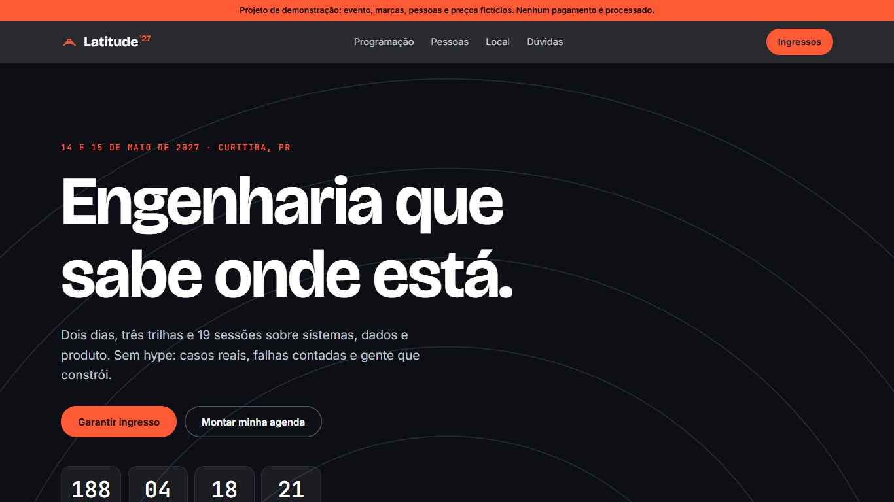
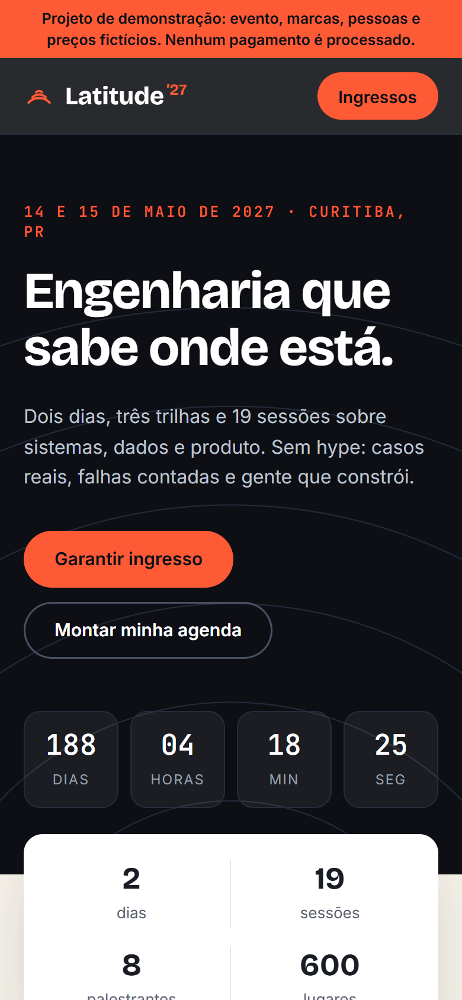

# Latitude '27 — tech conference landing page

[](https://github.com/alissonlittig/latitude-conf/actions/workflows/ci.yml)

**Live demo:** https://alissonlittig.github.io/latitude-conf/

A landing page for a fictional two-day engineering, data and product conference. Everything (brand, speakers, companies, prices) is fictional and flagged as a demo on the page. No payment is processed.




## Features
- Interactive schedule: day tabs, track filter, text search.
- "My agenda": star sessions (saved in `localStorage`), clash detection for overlapping slots, `.ics` export for any calendar app.
- Ticket picker with quantity limits, a team minimum (5+) and a test coupon (`LATITUDE10`).
- Live countdown, speaker grid, venue section, FAQ.
- Responsive down to 390 px with no horizontal scroll; keyboard friendly, `prefers-reduced-motion` respected.

## Stack
Vite + vanilla JavaScript (no framework), plain CSS, Vitest. Pure logic (filtering, conflicts, pricing, ICS) lives in `src/lib.js` and is unit tested.

Lighthouse (mobile, local build): Performance 99 · Accessibility 97 · Best Practices 100 · SEO 91.

## Run
```bash
npm ci
npm run dev     # local dev server
npm test        # unit tests
npm run build   # static output in dist/
```

CI (`.github/workflows/ci.yml`) runs tests and build on every push, then deploys `dist/` to GitHub Pages from `main`.

## Notes
Demo project by Alisson Littig. Fictional data only; no secrets or real personal data.
